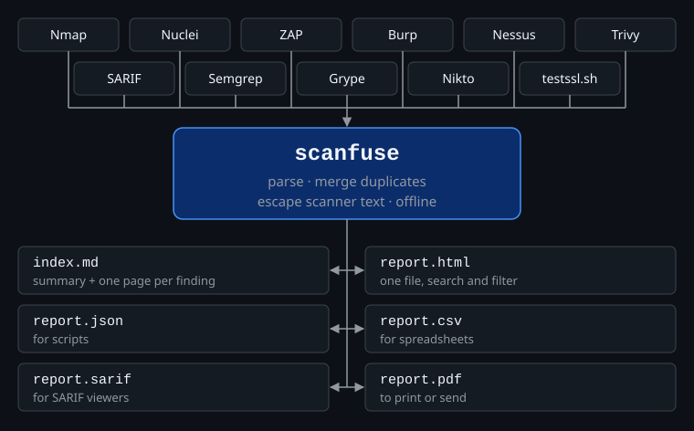

# scanfuse

[](https://pypi.org/project/scanfuse/)
[](https://github.com/gencay-e/scanfuse/blob/main/LICENSE)
[](https://github.com/gencay-e/scanfuse/actions/workflows/ci.yml)

`scanfuse` is an offline CLI that normalizes scan output across 11 scanner output formats (Nmap, Nuclei, OWASP ZAP, Burp Suite, Nessus, Trivy, SARIF, Semgrep, Grype, Nikto, and testssl.sh), deduplicates findings across tools and hosts, and writes unified reports as Markdown, standalone HTML, JSON, CSV, SARIF, or PDF. It runs locally and makes no network requests.



Release history is in [CHANGELOG.md](https://github.com/gencay-e/scanfuse/blob/main/CHANGELOG.md). Security guarantees and threat boundaries are in [SECURITY.md](https://github.com/gencay-e/scanfuse/blob/main/SECURITY.md) and [docs/security-model.md](https://github.com/gencay-e/scanfuse/blob/main/docs/security-model.md).

## Example


`report.html` adapts automatically to system light and dark preferences and includes an interactive search bar, severity filter, and persistent theme selector. The screenshots above come from the sample report in [examples/](https://github.com/gencay-e/scanfuse/tree/main/examples), generated from five tools (Nmap, ZAP, Trivy, Burp, and Nessus).

## Install

Requires Python 3.12 or newer:

```bash
pipx install scanfuse                                   # from PyPI
pipx install git+https://github.com/gencay-e/scanfuse   # latest main branch
```

You can also install with `pip install scanfuse`, or from a local checkout with `pipx install .`.

Standalone executables for Linux (`x86_64`), Windows (`x86_64`), and macOS (`arm64`) are attached to each release on the [Releases page](https://github.com/gencay-e/scanfuse/releases) along with `SHA256SUMS`. To compile your own executable, see [Development and building](#development-and-building).

## Usage

```bash
scanfuse scan.xml -o report
scanfuse nmap.xml nuclei.json zap.xml -o report
scanfuse scan.json -f trivy --format-out json -o report
scanfuse scan.xml --min-severity High --host 192.0.2.1 -o report
scanfuse scan.xml --config rules.yaml --baseline previous/report.json -o retest
cat scan.json | scanfuse -o report
```

Pass one or more scan files, or `-` to read standard input. Format detection (`-f auto`, the default) handles all 11 formats automatically; specify `-f` when an input is ambiguous or minimal (such as an empty JSON array).

### Options

| Option | Meaning |
|---|---|
| `-f`, `--format` | Input format (`auto` by default): `nmap`, `nuclei`, `zap`, `burp`, `nessus`, `trivy`, `sarif`, `semgrep`, `grype`, `nikto`, `testssl`. |
| `-c`, `--config` | YAML configuration file (defaults to `.scanfuse.yaml` in the current directory). |
| `--baseline` | Compare against a complete schema version 2 `report.json` to mark findings `new`, `unchanged`, or `resolved`. |
| `-o`, `--output` | Output directory (default: `report`). |
| `--format-out` | `markdown` (default), `json`, `csv`, `sarif`, or `pdf`. `markdown` writes `index.md`, one `.md` file per finding, and `report.html`. |
| `-s`, `--min-severity` | Minimum severity to export (`Critical`, `High`, `Medium`, `Low`, or `Info`; case-insensitive). |
| `--host` | Keep only findings affecting this IP or host name (case-insensitive, supports `*` and `?` wildcards). Applied before merging. |
| `-t`, `--template-dir` | Custom template folder with `finding.md.j2` and/or `index.md.j2`. Missing templates fall back to built-in defaults. |
| `--replace` | Overwrite an existing report in the output directory and prune untouched stale files tracked in the manifest. |
| `--csv-excel` | Write `report.csv` with a UTF-8 BOM and `;` separator for Excel in semicolon locales. |
| `--version` | Show the installed version and exit. |

### Input formats

| `-f` | Supported formats and parser behavior |
|---|---|
| `nmap` | Nmap XML, including service CPE IDs and highest-accuracy OS guesses. |
| `nuclei` | Nuclei JSON and JSONL. Retains per-URL paths and queries in `observations`. |
| `zap` | OWASP ZAP XML (1.x and 2.x), including `param`, `attack`, `otherinfo`, CWE, and WASC IDs. |
| `burp` | Burp Suite XML issues export, preserving HTTP request/response evidence and classifications. |
| `nessus` | Tenable `.nessus` XML (IPv4 and IPv6 addresses, CVSS scores, and plugin IDs). |
| `trivy` | Trivy JSON object and legacy list reports (vulnerabilities and misconfigurations). |
| `sarif` | SARIF 2.1.0 (CodeQL, Semgrep `--sarif`, and others). Uses rule title/name as title and `path:line` as location. |
| `semgrep` | Semgrep `--json`, retaining CWE/CVE metadata and `path:line` locations. |
| `grype` | Grype `-o json`, selecting the highest valid CVSS score and matching vector. |
| `nikto` | Nikto JSON (host lists or nested wrapper objects), XML, and CSV, keeping HTTP methods and URLs with query strings. |
| `testssl` | testssl.sh `--jsonfile` and `--jsonfile-pretty`. Skips non-finding statuses (`OK`, `INFO`, `DEBUG`, `NONE`, `WARN`, `WARNING`); stops with an import error on `FATAL`. |

### Existing reports and safe overwriting

`scanfuse` builds reports in a staging directory before publishing and stops with exit code 2 if target files already exist without `--replace`.

With `--replace`, stale files from a previous run are removed only when `.scanfuse-manifest-<kind>.json` lists them as plain file names (never dotfiles or subpaths) with a matching SHA-256 digest. Files edited manually after generation or listed without digests (manifests from 1.0.2 or earlier) are preserved. Because the manifest itself is unauthenticated, anyone with write access to the output directory can alter files in it.

If replacement fails mid-step, `scanfuse` restores the prior files from staging and keeps the backup directory path in the error message if recovery fails. A process crash or power loss during replacement can still leave mixed state. PDF exports write directly without a manifest file.

### Incomplete runs and exit codes

An input, configuration, or baseline error makes `scanfuse` exit with code 1. If the run recovered findings, requested a baseline comparison, or encountered a configuration error, it writes a report marked incomplete. JSON sets `"complete": false` and lists `errors`, Markdown and HTML show an **INCOMPLETE** banner, CSV uses `Import Status`, SARIF sets `executionSuccessful: false`, and PDF lists import errors.

| Code | Meaning |
|---|---|
| `0` | Completed cleanly. |
| `1` | Incomplete or failed: an input file, `.scanfuse.yaml`, or `--baseline` failed to load, no input was given, or writing failed. |
| `2` | Invalid arguments, `--output` points to an existing file, or output files already exist without `--replace`. |

## Deduplication and filter order

Findings from multiple inputs are merged when all five keys match:

* Title (ignoring surrounding whitespace and case)
* Shared non-tool identifiers (`CVE`, `GHSA`, `CWE`, `WASC`)
* Port
* Set of `(method, location)` pairs from `observations` (HTTP methods normalized to upper case; URL paths, parameters, and `path:line` values compared case-sensitively)
* Tool-local IDs when reported by the same tool (e.g., two distinct Nessus plugin IDs remain separate)

Merged findings preserve every host, observation, and raw evidence entry (tagged with `source` and `hosts`), keeping per-tool descriptions, severities, and remediations under **Reported by** (`sources` in JSON). The consolidated severity is the maximum reported severity; the summary CVSS score is the highest valid base score paired with its own vector. If tools supply CVSS vectors whose base metrics disagree, `cvss_merge_conflict` is set to `true`.

Processing order:

1. `--host` filter on raw parsed findings (dropping unmatching observations and attributed evidence so merged scores reflect only selected hosts).
2. Deduplication.
3. `overrides` and `exclusions` from configuration.
4. `--baseline` retest comparison (when enabled).
5. `ignore_titles` from configuration.
6. `--min-severity`.

## Outputs

### JSON (`report.json`)

Schema version 2 writes a top-level object:

```json
{
  "schema_version": 2,
  "complete": true,
  "errors": [],
  "findings": [
    {
      "status": null,
      "title": "SQL Injection",
      "severity": "High",
      "cvss_score": 8.6,
      "cvss_vector": null,
      "description": "...",
      "remediation": null,
      "hosts": [{"ip": "10.0.0.1", "hostname": null, "os": null, "port": null}],
      "evidence": [],
      "source_tool": "zap",
      "slug": null,
      "identifiers": ["CVE-2024-0001"],
      "references": [],
      "port": "443/tcp",
      "observations": [
        {"host": "10.0.0.1", "method": "POST", "location": "/account", "source_tool": "zap"}
      ],
      "sources": [],
      "tags": [],
      "cvss_merge_conflict": false
    }
  ],
  "resolved": []
}
```

### CSV (`report.csv`)

Columns: `Title`, `Severity`, `CVSS`, `Hosts`, `Source Tool`, `Description`, `Remediation`, `Evidence`, `CVSS Vector`, `Port`, `Identifiers`, `References`, `Other Reports`, `Import Status`, `Affected`, `Retest Status`.

Every cell passes through spreadsheet formula neutralization: cells whose first non-whitespace, non-control, non-format character (after NFKC normalization) is `=`, `+`, `-`, or `@` are prefixed with `'`, as are raw values beginning with `\t`, `\r`, `\n`, space, or `\ufeff`. Plain values starting only with `\u00a0`, `\u200b`, or `\v` are left unmodified.

When opening `--csv-excel` files in Microsoft Excel via **Data > From Text/CSV** with `;` delimiter, disable automatic data type detection so IP addresses (such as `192.0.2.1`) are not converted into numbers.

### SARIF (`report.sarif`)

Exports SARIF 2.1.0 with one rule per finding, encoding affected hosts as `logicalLocations` (`kind: "resource"`) and full observations in result `properties`. Because network and URL findings lack source file `physicalLocation` entries, this output targets SARIF viewers and aggregators rather than GitHub code scanning upload.

### PDF (`report.pdf`)

Generates a paged PDF report with severity summary counts, import error notices, per-finding pages with hosts, tags, source summaries, and evidence capped at 12,000 characters per item. Uses installed system Unicode fonts (Arial/Segoe UI on Windows, DejaVu/FreeSans/Liberation on Linux, Arial on macOS), falling back to Latin-1 replacement (`?`) when no Unicode font is present.

## Configuration (`.scanfuse.yaml`)

`scanfuse` loads `.scanfuse.yaml` in the working directory or the file specified via `-c` / `--config`. Both paths enforce strict schema validation (rejecting duplicate keys, unknown fields, and invalid types).

```yaml
ignore_titles:
  - "Wappalyzer"
  - "Header Missing"

overrides:
  - cve: CVE-2024-1234
    severity: High
    tags: [confirmed]
  - host: "10.0.0.*"
    port: "443/tcp"
    severity: Low

exclusions:
  - tool_id: "nessus-plugin:10202"
  - source_tool: "nikto"
    title: "*header*"
    location: "/admin*"
```

* `cve` and `tool_id` match complete finding identifiers case-insensitively (for example `CVE-2024-1234`, `nessus-plugin:10202`, or `zap-plugin:10202`).
* `port` matches the numeric port when given without protocol (`80` matches `80/tcp`) or exact string otherwise.
* `host` matches IP or host name case-insensitively with `*` and `?` wildcards.
* `source_tool` and `title` match case-insensitively (substring, or wildcard if `*`, `?`, or `[` is present); `location` matches observation locations case-sensitively.
* Every rule requires at least one match key. `severity` and `tags` are allowed only in `overrides`.

## Retest baseline comparison (`--baseline`)

Generate a JSON report on the initial test and pass it to `--baseline` during the retest using the same scope and filters:

```bash
scanfuse initial.xml --format-out json -o initial
scanfuse retest.xml --baseline initial/report.json -o retest
```

* Active findings matching an entry in the baseline are marked `unchanged`; new ones are marked `new`.
* Baseline findings absent from a **complete** retest are marked `resolved` (and filtered through current `--host`, configuration, and `--min-severity` settings). Incomplete retest runs never mark findings resolved.
* Comparison uses the merge identity (without host names), so a finding remains `unchanged` if its IP/host label changes while title, IDs, port, and places match.

## Development and building

```bash
uv sync --locked --extra dev
uv run playwright install chromium
uv run ruff check .
uv run mypy scanfuse
uv run pytest tests/
```

Build a standalone binary with PyInstaller:

```bash
uv run python build.py
```

The binary is written to `dist/`. Verify packaged execution with:

```bash
SCANFUSE_EXE=dist/scanfuse uv run pytest tests/test_packaged_cli.py
```

On Windows PowerShell:

```powershell
$env:SCANFUSE_EXE = (Resolve-Path .\dist\scanfuse.exe).Path
uv run pytest tests/test_packaged_cli.py
```

Check throughput on synthetic workloads with `uv run python tools/large_check.py 100000`. Note that standalone Linux binaries link dynamically against the build host's glibc; build on the oldest target base OS you support.

## Limits and security posture

* **Untrusted inputs:** XML parsers use `defusedxml` (blocking external entities and entity expansion without resolving external DTDs). Scalar report fields are Markdown-escaped, HTML fragments pass through `nh3`, and evidence sits in dynamic backtick fences. Scanner `http`/`https` links inside descriptions and references remain clickable.
* **PDF scale:** Rendering large PDFs is CPU-bound in `fpdf2`; use Markdown, JSON, or CSV for scans with thousands of findings.
* **CI scope:** Release builds run tests on Ubuntu 22.04 (`x86_64`), Windows (`x86_64`), and macOS (`arm64`) plus Chromium browser checks for `report.html`. Excel Power Query tests run when Windows Excel is present.

## Contributing and License

See [CONTRIBUTING.md](https://github.com/gencay-e/scanfuse/blob/main/CONTRIBUTING.md) before opening a PR. MIT License ([LICENSE](https://github.com/gencay-e/scanfuse/blob/main/LICENSE)); standalone archives bundle third-party notices (including LGPL-3.0 `fpdf2`) in `THIRD_PARTY_LICENSES.txt`.
