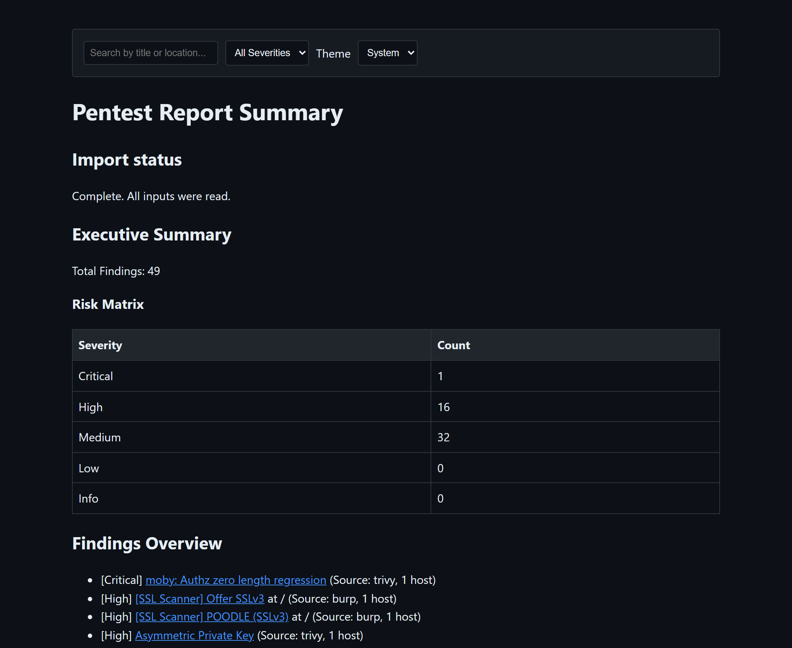
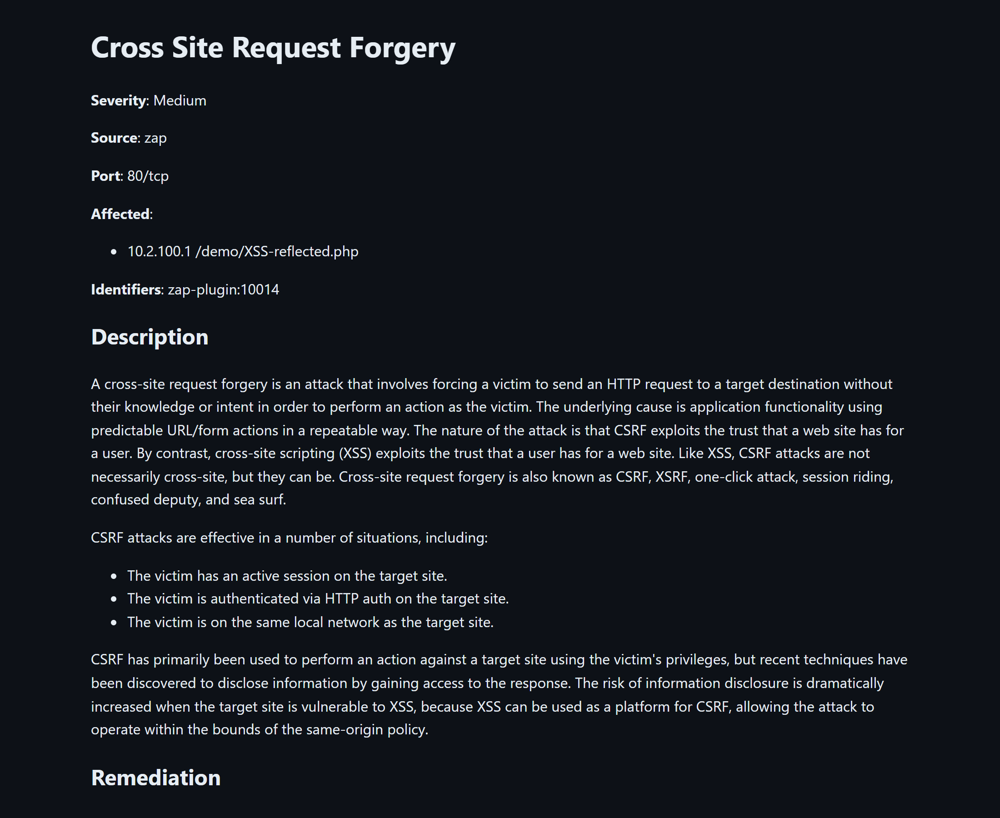

# scanfuse

[](https://pypi.org/project/scanfuse/)
[](https://github.com/gencay-e/scanfuse/blob/main/LICENSE)
[](https://github.com/gencay-e/scanfuse/actions/workflows/ci.yml)

`scanfuse` parses output from Nmap, Nuclei, OWASP ZAP, Burp Suite, Nessus, Trivy, SARIF, Semgrep, Grype, Nikto and testssl.sh, merges duplicate findings across scanners, and writes a single report as Markdown (with an index and a standalone HTML page), JSON, CSV, SARIF or PDF. It runs offline and makes no network calls.


Release notes are in [CHANGELOG.md](https://github.com/gencay-e/scanfuse/blob/main/CHANGELOG.md).

## Example





Screenshots from the example report in examples/ (captured in 1.1.0; layout unchanged in 1.2.0).

`report.html` follows the light or dark setting of your system by default. The Theme menu switches between System, Light and Dark and remembers the choice in the browser. The screenshots show the dark theme.

The report above was made from six real scan files from five tools (Nmap, ZAP, Trivy, Burp, Nessus). The input files, the
command and the full report are in [examples/](https://github.com/gencay-e/scanfuse/tree/main/examples).

## Install

You need Python 3.12 or newer.

```bash
pipx install scanfuse                                   # from PyPI
pipx install git+https://github.com/gencay-e/scanfuse   # latest state from GitHub
```

`pip install scanfuse` works as well. From a checkout of this repository: `pipx install .`

Ready-made programs for Linux, Windows and macOS (no Python needed) are on the [Releases page](https://github.com/gencay-e/scanfuse/releases), with a `SHA256SUMS` file. To build one yourself, see [Build a standalone program](#build-a-standalone-program).

## Use

```bash
scanfuse scan.xml -o report
scanfuse nmap.xml nuclei.json zap.xml -o report
scanfuse scan.json -f trivy --format-out json -o report
scanfuse scan.xml --min-severity High --host 192.0.2.1 -o report
scanfuse scan.xml --config rules.yaml --baseline previous/report.json -o retest
cat scan.json | scanfuse -o report
```

`scanfuse` takes one or more files, or `-` for standard input. It detects all 11 supported formats automatically. Use `-f` if detection fails or to choose a format explicitly.

| Option | Meaning |
|---|---|
| `-f`, `--format` | Input format. `auto` (default) detects `nmap`, `nuclei`, `zap`, `burp`, `nessus`, `trivy`, `sarif`, `semgrep`, `grype`, `nikto` and `testssl`. |
| `-c`, `--config` | Configuration YAML file. Defaults to `.scanfuse.yaml` in the current directory. |
| `--baseline` | Compare against a complete schema version 2 JSON report. |
| `-o`, `--output` | Output directory. Default `report`. |
| `--format-out` | `markdown` (default), `json`, `csv`, `sarif` or `pdf`. `markdown` writes one file per finding, `index.md` and `report.html`. |
| `-s`, `--min-severity` | `Critical`, `High`, `Medium`, `Low` or `Info`. Case does not matter. |
| `--host` | Only findings on this host. Must match the IP or host name exactly, ignoring case. `*` and `?` are wildcards, for example `10.0.0.*`. Applied before merging; see Host filter. |
| `-t`, `--template-dir` | Folder with your own `finding.md.j2` and `index.md.j2`. The folder must exist. Missing files fall back to the built-in templates. |
| `--replace` | Overwrite an existing report. See below. |
| `--csv-excel` | CSV with a byte order mark and `;` as separator, which German-language Excel expects. |
| `--version` | Print the version. |

### Additional input formats

These formats can be detected automatically or selected with `-f`:

| `-f` | Tool and file |
|---|---|
| `sarif` | Any SARIF 2.1.0 file (CodeQL, Semgrep `--sarif` and others). The title is the rule's short description or name, the result message goes into the description. |
| `semgrep` | Semgrep `--json` |
| `grype` | Grype `-o json`. CVSS score and vector are taken from the highest valid score. |
| `nikto` | Nikto `-Format json` (a list of hosts), `-Format xml`, and `-Format csv`. |
| `testssl` | testssl.sh `--jsonfile` and `--jsonfile-pretty`. `OK`, `INFO` and `WARN` lines are skipped; `FATAL` marks the file as unreadable. |

```bash
scanfuse results.sarif -f sarif -o report
scanfuse testssl.json -f testssl -o report
```

If a file is read wrongly, open an issue with a cleaned sample.

### Existing reports

`scanfuse` never overwrites files by accident. If the output directory already contains a file that the new report would write, it stops with exit code 2 and changes nothing. Add `--replace` to overwrite the report. With `--replace`, files of the earlier report that are no longer part of it are removed, but only if they are listed in the manifest in the report folder and still have the SHA-256 recorded there. Changed files, unlisted files and files listed in a manifest from scanfuse 1.0.2 or earlier (no digests) are left alone.

When the manifest is trusted, the digest check prevents cleanup of files that changed since scanfuse wrote them. The manifest is not authenticated and does not prove that scanfuse created a file; anyone who can edit the report folder can also delete files in it.

The report is built in a temporary folder first. If moving the files fails, scanfuse tries to restore the old report. If restoration also fails, the error gives the location of the retained backup. A process or system crash during replacement can still leave a mixed report.

### Incomplete runs

If one input file cannot be read, scanfuse still writes the findings from the other files and exits with code 1. The report says so:

* `report.json`: `"complete": false` and the list of `errors`.
* `index.md` and `report.html`: an **INCOMPLETE** notice with the errors.
* `report.csv`: the column `Import Status` says `incomplete (...)` in every row.
* `report.pdf`: the summary lists import errors.

An invalid configuration file counts as an error too. The report is then incomplete, because ignore rules were not applied.

### Exit codes

| Code | Meaning |
|---|---|
| 0 | Complete. |
| 1 | Incomplete or failed: an input could not be read, `.scanfuse.yaml` is invalid, nothing could be written, or no input was given. |
| 2 | Invalid option, or the output files already exist (use `--replace`). This also applies to PDF output. |

## Merging duplicates

Findings from several files are merged when they are the same finding:

* the titles are equal, ignoring case and surrounding spaces,
* they carry the same ids that do not belong to one tool (CVE, GHSA, CWE, WASC),
* they have the same port,
* they have the same set of affected places, and
* the same tool does not give them different tool ids (for example two Nessus plugin ids).

An affected place is a pair of HTTP method and location. The location is the URL path of the affected page, with the parameter if the tool names one; the method is in upper case. Every tool reports where it saw a finding as observations (host, method, location, tool): ZAP gives one per alert instance, Burp one per issue, Nuclei one per result (the URL path and query of a web match; none for a match on a port), and Nikto one per HTTP finding. ZAP locations also retain query strings. SARIF and Semgrep use the file path and start line (`path:line`); the remaining tools give the host. The set of places is taken from these observations. Two findings are merged only if their sets are equal. Locations and parameter names are compared exactly, because URL paths are case-sensitive: `/Admin` and `/admin` are two locations, and so are `/admin` and `/admin/`. Only surrounding spaces and the case of the method are ignored. Findings without any place are merged only with findings that also have none.

So the same title at two different paths (for example "SQL Injection" at `/login` and at `/search`), or with `GET /account` and `POST /account`, stays two findings. A ZAP alert with several instances is one finding that lists all of them. Two such alerts with the same set of places (on the same host or on others) are merged; if the sets differ, even on different hosts, they stay two findings. The same finding on several hosts is merged into one finding that lists every host and every piece of evidence.

Titles that are only similar are not merged. A merged finding keeps all hosts, all observations and all evidence. Each observation names the tool that reported it. Evidence shows which tool reported it and, after a merge, which host it belongs to. What each tool wrote (description, remediation, severity, CVSS score and vector, ids) is listed under **Reported by** in the Markdown and in `sources` in the JSON. The summary severity is the highest of all reports. The summary CVSS score is the highest score, together with its own vector. If the tools give CVSS vectors with different base metrics, `cvss_merge_conflict` is `true` in the JSON.

### Host filter

`--host` is applied to the parsed findings before they are merged. A finding that affects none of the selected hosts is dropped, so severity, CVSS and sources of a merged finding come only from the selected hosts. A finding that lists several hosts keeps only the matching hosts and their observations. Evidence that names no host (from a single scanner finding that lists several hosts) is kept and may mention other hosts. The same holds for descriptions and remediation text, which are the scanner's own text.

Filters and rules run in this order:

1. `--host`, on the parsed findings.
2. Merging.
3. `overrides` and `exclusions` from `.scanfuse.yaml`.
4. Baseline comparison, when `--baseline` is given.
5. `ignore_titles` from `.scanfuse.yaml`.
6. `--min-severity`.

## Output

### JSON

`report.json` is an object:

```json
{
  "schema_version": 2,
  "complete": true,
  "errors": [],
  "findings": [ { "title": "...", "severity": "High", "identifiers": ["CVE-2024-0001"], "port": "443/tcp", "observations": [ { "host": "10.0.0.1", "method": "POST", "location": "/account", "source_tool": "zap" } ], "sources": [] } ],
  "resolved": []
}
```

`observations` lists where each tool saw the finding, and `resolved` lists findings absent from a `--baseline` retest. `method` and `location` are `null` for tools that give none. `schema_version` stays 2: `observations`, `resolved` and the `hosts` list of `evidence` are additions that older readers can ignore.

### CSV

Columns: `Title`, `Severity`, `CVSS`, `Hosts`, `Source Tool`, `Description`, `Remediation`, `Evidence`, `CVSS Vector`, `Port`, `Identifiers`, `References`, `Other Reports`, `Import Status`, `Affected`, `Retest Status`. `Hosts` shows `ip (host name)` when a host name is known. `Affected` shows host, method and location from the observations, for example `10.0.0.1 POST /account [id parameter]`, one per line.

Cells that start with `=`, `+`, `-` or `@` get a leading `'` to reduce the risk of spreadsheet formulas. This also covers look-alike characters such as a full-width `＝` and a leading no-break space. These cases were tested by reading the files back.

In Excel, import `--csv-excel` output with **Data > From Text/CSV** and use the semicolon delimiter. Disable automatic data type detection and check the imported values before using them: in one Excel test, automatic detection changed the host `192.0.2.1` to `192021`. Disabling detection can leave numeric values as text. In an earlier Windows Excel test, this import preserved a multiline evidence field; the older Text Import Wizard split it across rows. These import observations come from manual tests in Windows Excel. The automated Power Query test checks formula-like values when Windows Excel is installed; behavior in other Excel versions and LibreOffice is unverified.

### SARIF

`--format-out sarif` writes `report.sarif` (SARIF 2.1.0) with one rule per finding. The output is for SARIF viewers and aggregators. It is not meant for GitHub code scanning upload: GitHub requires a file location (`physicalLocation`) with a line number in every result, and a host or URL path is not a file. scanfuse therefore writes each host as a logical location (`logicalLocations`, kind `resource`) and puts the hosts and the observations in the `properties` of the result. The output was checked against the official SARIF 2.1.0 JSON schema.

### PDF

`--format-out pdf` writes `report.pdf` with a summary containing severity counts and import errors. Finding pages include hosts, tags, source summaries and evidence. Each evidence item is limited to 12,000 characters in the PDF; use Markdown or JSON for the full text. Each finding starts on a new page, with its affected hosts, methods and locations after the hosts, and long findings continue on further pages. It uses a Unicode font of the system (Arial or Segoe UI on Windows, DejaVu, FreeSans or Liberation on Linux, Arial on macOS). Without one, characters outside Latin-1 are replaced by `?`. The PDF is slow for large scans: 5,000 findings took 40 seconds and made a 3.6 MB file. Use Markdown, JSON or CSV for very large reports.

### Scanner text in the report

Scanner output is untrusted. scanfuse treats it like this:

* Titles, host names, ids and tool names are shown as plain text. They cannot add links, headings or HTML.
* Descriptions and remediation text keep Markdown formatting, including links. Raw HTML is escaped, and the text cannot create a heading. A link in a scanner description is shown as the scanner wrote it, so check it before you click.
* Evidence is shown unchanged in a code block.
* The HTML page removes scripts, images, frames and `javascript:` links.
* XML with entity declarations is rejected.

## Configuration: `.scanfuse.yaml`

`scanfuse` reads `.scanfuse.yaml` from the current directory, or the file selected with `--config` / `-c`. Both use the same strict YAML loader. Duplicate keys, unknown keys, invalid rules and invalid field values are reported as errors; the report is incomplete and the rules are not applied.

```yaml
ignore_titles:
  - "Wappalyzer"
  - "Header Missing"
```

Findings whose title contains one of these texts (ignoring case) are left out. `ignore_titles` must be a list of strings. A single string is read as a list with one entry. Anything else, a file that is not a mapping, or a YAML syntax error is reported as an error and the rules are not applied.

`overrides` change the severity of matching findings or add tags, `exclusions` leave matching findings out:

```yaml
overrides:
  - cve: CVE-2024-1234          # matches any id of the finding (CVE, GHSA, tool id)
    severity: High               # Critical, High, Medium, Low or Info
    tags: [confirmed]
  - host: "10.0.0.*"
    port: "443/tcp"
    severity: Low
exclusions:
  - tool_id: "10202"
  - host: "test-*.example.test"
  - source_tool: "nikto"
    title: "*header*"
    location: "/admin*"
```

A rule matches when all of its keys match: `cve` and `tool_id` against the finding's ids (ignoring case), `port` by number when no protocol is given (`80` matches `80/tcp`), otherwise exactly, and `host` against IP or host name with `*` and `?`. `source_tool` and `title` match case-insensitively, while `location` matches observation locations case-sensitively. These three fields match a substring, or a wildcard pattern when the value contains `*`, `?` or `[`. Each rule must contain a match field. `severity` and `tags` are override actions and are rejected in exclusions. Overrides are applied in order; a later severity wins and tags are combined. Overrides and exclusions are applied after merging and before `--min-severity`, so a raised severity is not filtered out. `overrides` or `exclusions` that are not lists are reported as an error.

## Compare a retest

Create a JSON report for the initial scan, then pass it to `--baseline` on the retest:

```bash
scanfuse initial.xml --format-out json -o initial
scanfuse retest.xml --baseline initial/report.json -o retest
```

The baseline must be a complete schema version 2 JSON report. Apply the same scan scope, host filter, severity threshold and configuration to both runs. Comparison uses the merge identity described above and does not include hosts, so a host change alone does not change the status. Current findings are marked `new` or `unchanged`; findings absent from a complete retest are `resolved`. Comparison runs before title and severity filters, so an active finding whose severity was lowered is not marked resolved. An incomplete retest does not mark any findings resolved. The current host, configuration and severity filters also apply to the resolved list. Markdown/HTML and PDF list resolved findings, JSON includes a `resolved` array, and CSV includes active finding status.

## Build a standalone program

```bash
uv sync --extra dev
uv run python build.py
```

The program is written to `dist/`. To check it against the test suite:

```bash
SCANFUSE_EXE=dist/scanfuse uv run pytest tests/test_packaged_cli.py     # Linux, macOS
$env:SCANFUSE_EXE = (Resolve-Path .\dist\scanfuse.exe).Path             # Windows PowerShell
```

A program built on Linux depends on the C library of the system it was built on. Build on the oldest system you want to support.

## Development

```bash
uv sync --locked --extra dev
uv run ruff check .
uv run mypy scanfuse
uv run pytest tests/
```

## Limits

* Parser coverage includes public and synthetic samples. Scanner versions and file variants may add fields that scanfuse does not read; open an issue with a cleaned sample if a file fails.
* Format detection inspects the start of a file. Use `-f` if detection fails or guesses wrong.
* Automated browser tests exercise report controls and a representative untrusted payload in Chromium. Excel Power Query formula-import tests run only when Windows Excel is installed; they skip otherwise. These tests do not establish behavior in every browser, Excel version or LibreOffice.
* 100,000 results were processed completely in all three output formats on one Linux machine (4 CPUs, 16 GB). JSON took 14 seconds, CSV 10 seconds, Markdown with HTML 124 seconds, and the peak memory was between 0.7 and 1.0 GB. The HTML page for that many findings is large. You can repeat the check with `python tools/large_check.py 100000`.
* Standalone programs are built and tested in CI on Ubuntu 22.04 (x86_64), Windows (x86_64) and macOS (arm64). Other Linux distributions, Linux on ARM and macOS on Intel were not tested.

## License

MIT, see [LICENSE](https://github.com/gencay-e/scanfuse/blob/main/LICENSE). The standalone programs include third-party packages, among them fpdf2 (LGPL-3.0). Their licenses are in `THIRD_PARTY_LICENSES.txt` in each release archive.
