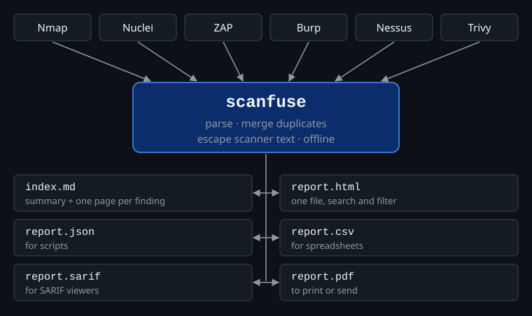
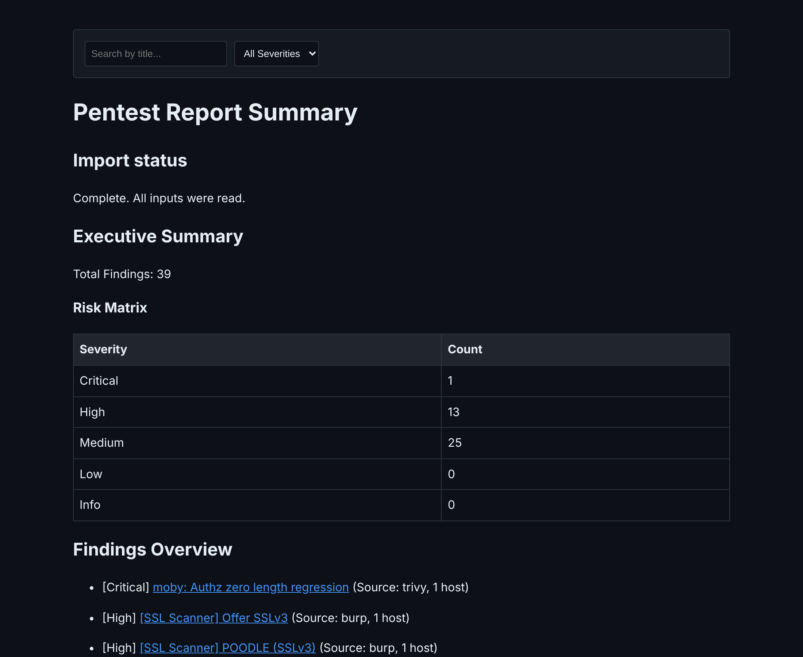
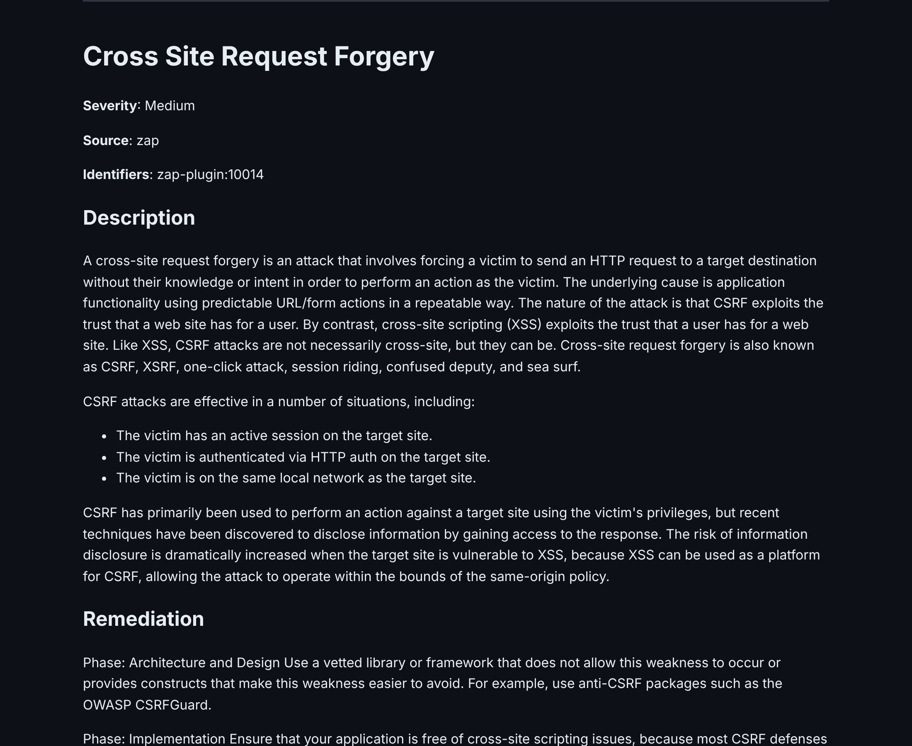

# scanfuse

A local command-line tool that reads pentest scanner reports and writes one report from them.



It imports Nmap, Nuclei, ZAP, Burp, Nessus and Trivy files and writes Markdown (with an index and a standalone HTML page), JSON or CSV. It runs offline and sends nothing anywhere.

Version 0.2.0, a pre-release. See [CHANGELOG.md](CHANGELOG.md).

## Example





`report.html` follows the light or dark setting of your system; the screenshots show the dark one.

The report above was made from six real scan files (Nmap, ZAP, Trivy, Burp, Nessus). The input files, the
command and the full report are in [examples/](examples/).

## Install

You need Python 3.12 or newer.

```bash
pipx install scanfuse                                   # from PyPI
pipx install git+https://github.com/gencay-e/scanfuse   # latest state from GitHub
```

`pip install scanfuse` works as well. From a checkout of this repository: `pipx install .`

Ready-made programs for Linux, Windows and macOS (no Python needed) are on the [Releases page](https://github.com/gencay-e/scanfuse/releases), with a `SHA256SUMS` file. To build one yourself, see [Build a standalone program](#build-a-standalone-program).

## Use

```bash
scanfuse scan.xml -o report
scanfuse nmap.xml nuclei.json zap.xml -o report
scanfuse scan.json -f trivy --format-out json -o report
scanfuse scan.xml --min-severity High --host 192.0.2.1 -o report
cat scan.json | scanfuse -o report
```

`scanfuse` takes one or more files, or `-` for standard input. It finds the format by itself. Use `-f` to choose one: `nmap`, `nuclei`, `zap`, `burp`, `nessus`, `trivy`.

| Option | Meaning |
|---|---|
| `-o`, `--output` | Output directory. Default `report`. |
| `--format-out` | `markdown` (default), `json` or `csv`. `markdown` writes one file per finding, `index.md` and `report.html`. |
| `-s`, `--min-severity` | `Critical`, `High`, `Medium`, `Low` or `Info`. Case does not matter. |
| `--host` | Only findings on this host. Must match the IP or host name exactly, ignoring case. `*` and `?` are wildcards, for example `10.0.0.*`. |
| `-t`, `--template-dir` | Folder with your own `finding.md.j2` and `index.md.j2`. The folder must exist. Missing files fall back to the built-in templates. |
| `--replace` | Overwrite an existing report. See below. |
| `--csv-excel` | CSV with a byte order mark and `;` as separator, which German-language Excel expects. |
| `--version` | Print the version. |

### Existing reports

`scanfuse` never overwrites files by accident. If the output directory already contains a file that the new report would write, it stops with exit code 2 and changes nothing. Add `--replace` to overwrite the report. With `--replace`, files of the earlier report that are no longer part of it are removed. Files that scanfuse did not write are left alone.

The report is built in a temporary folder first. If moving the files fails, scanfuse tries to restore the old report. If restoration also fails, the error gives the location of the retained backup. A process or system crash during replacement can still leave a mixed report.

### Incomplete runs

If one input file cannot be read, scanfuse still writes the findings from the other files and exits with code 1. The report says so:

* `report.json`: `"complete": false` and the list of `errors`.
* `index.md` and `report.html`: an **INCOMPLETE** notice with the errors.
* `report.csv`: the column `Import Status` says `incomplete (...)` in every row.

An invalid `.scanfuse.yaml` counts as an error too. The report is then incomplete, because ignore rules were not applied.

### Exit codes

| Code | Meaning |
|---|---|
| 0 | Complete. |
| 1 | Incomplete or failed: an input could not be read, `.scanfuse.yaml` is invalid, nothing could be written, or no input was given. |
| 2 | Invalid option, or the output files already exist (use `--replace`). |

## Merging duplicates

Findings from several files are merged when they are the same finding:

* the titles are equal, ignoring case and surrounding spaces,
* they carry the same CVE or GHSA ids,
* they have the same port, and
* the same tool does not give them different tool ids (for example two Nessus plugin ids).

Titles that are only similar are not merged. A merged finding keeps all hosts and all evidence. Evidence shows which tool reported it. What each tool wrote (description, remediation, severity, CVSS score and vector, ids) is listed under **Reported by** in the Markdown and in `sources` in the JSON. The summary severity is the highest of all reports. The summary CVSS score is the highest score, together with its own vector.

## Output

### JSON

`report.json` is an object:

```json
{
  "schema_version": 2,
  "complete": true,
  "errors": [],
  "findings": [ { "title": "...", "severity": "High", "identifiers": ["CVE-2024-0001"], "port": "443/tcp", "sources": [] } ]
}
```

### CSV

Columns: `Title`, `Severity`, `CVSS`, `Hosts`, `Source Tool`, `Description`, `Remediation`, `Evidence`, `CVSS Vector`, `Port`, `Identifiers`, `References`, `Other Reports`, `Import Status`. `Hosts` shows `ip (host name)` when a host name is known.

Cells that start with `=`, `+`, `-` or `@` get a leading `'` to reduce the risk of spreadsheet formulas. This also covers look-alike characters such as a full-width `＝` and a leading no-break space. These cases were tested by reading the files back.

In Excel, import `--csv-excel` output with **Data > From Text/CSV** and use the semicolon delimiter. In a Windows Excel test, this preserved a multiline evidence field; the older Text Import Wizard split it across rows. Formula handling and LibreOffice remain unverified in those applications.

### Scanner text in the report

Scanner output is untrusted. scanfuse treats it like this:

* Titles, host names, ids and tool names are shown as plain text. They cannot add links, headings or HTML.
* Descriptions and remediation text keep Markdown formatting, including links. Raw HTML is escaped, and the text cannot create a heading. A link in a scanner description is shown as the scanner wrote it, so check it before you click.
* Evidence is shown unchanged in a code block.
* The HTML page removes scripts, images, frames and `javascript:` links.
* XML with entity declarations is rejected.

## Configuration: `.scanfuse.yaml`

`scanfuse` reads `.scanfuse.yaml` from the current directory.

```yaml
ignore_titles:
  - "Wappalyzer"
  - "Header Missing"
```

Findings whose title contains one of these texts (ignoring case) are left out. `ignore_titles` must be a list of strings. A single string is read as a list with one entry. Anything else, a file that is not a mapping, or a YAML syntax error is reported as an error and the rules are not applied.

## Build a standalone program

```bash
uv sync --extra dev
uv run python build.py
```

The program is written to `dist/`. To check it against the test suite:

```bash
SCANFUSE_EXE=dist/scanfuse uv run pytest tests/test_packaged_cli.py     # Linux, macOS
$env:SCANFUSE_EXE = (Resolve-Path .\dist\scanfuse.exe).Path             # Windows PowerShell
```

A program built on Linux depends on the C library of the system it was built on. Build on the oldest system you want to support.

## Development

```bash
uv sync --locked --extra dev
uv run ruff check .
uv run mypy scanfuse
uv run pytest tests/
```

## Limits

* scanfuse was tested with real output from nmap (7.94, 7.12, 6.40), ZAP 1.4, Burp, Nessus and Trivy (three file layouts), taken from the public [DefectDojo sample-scan-files](https://github.com/DefectDojo/sample-scan-files). Those files are old. Newer versions of the tools may add fields that scanfuse does not read yet. Nuclei has no real sample file in the tests. Open an issue with a cleaned sample if a file fails.
* Format detection looks at the start of the file. Use `-f` if it guesses wrong.
* The HTML page and the CSV file were checked by reading the files. They were not opened by hand in a browser, Excel or LibreOffice.
* 100,000 results were processed completely in all three output formats on one Linux machine (4 CPUs, 16 GB). JSON took 14 seconds, CSV 10 seconds, Markdown with HTML 124 seconds, and the peak memory was between 0.7 and 1.0 GB. The HTML page for that many findings is large. You can repeat the check with `python tools/large_check.py 100000`.
* Standalone programs are built and tested in CI on Ubuntu 22.04 (x86_64), Windows (x86_64) and macOS (arm64). Other Linux distributions, Linux on ARM and macOS on Intel were not tested.

## License

MIT, see [LICENSE](LICENSE).
